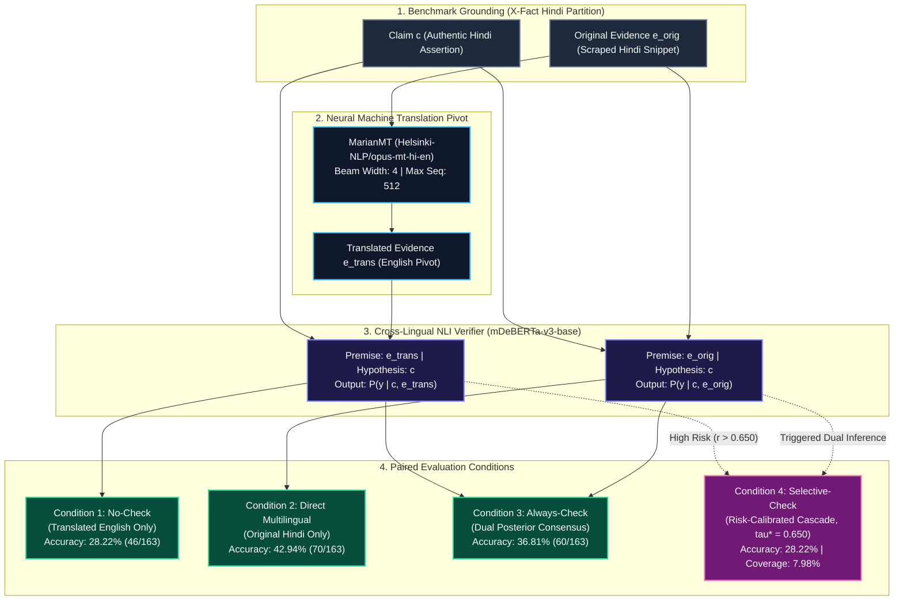
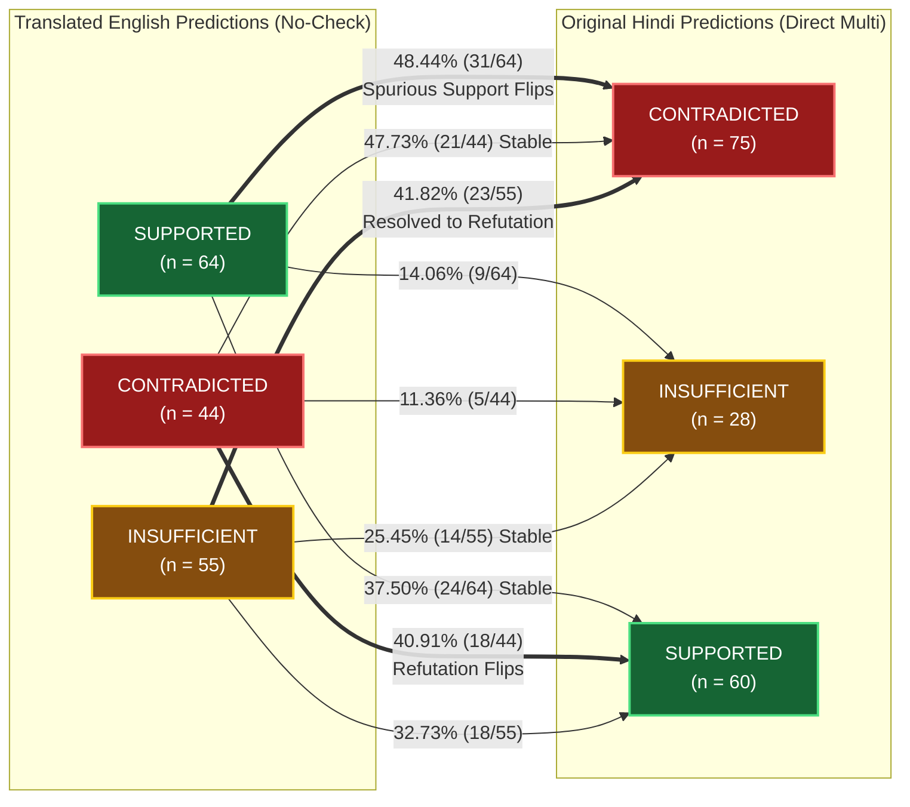
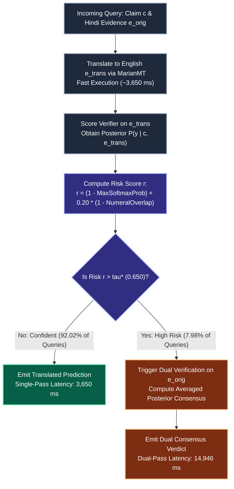

# Cross-Lingual Evidence Verification: Verifier Prediction Sensitivity Under Hindi-to-English Translation Shift

<div align="center">

[](file:///c:/Users/Onkar/OneDrive/Desktop/Research_crosslingual_rag_research/docs/research/research_scope.md)
[](file:///c:/Users/Onkar/OneDrive/Desktop/Research_crosslingual_rag_research/docs/manuscript/build_instructions.md)
[](file:///c:/Users/Onkar/OneDrive/Desktop/Research_crosslingual_rag_research/environment/requirements.txt)
[](file:///c:/Users/Onkar/OneDrive/Desktop/Research_crosslingual_rag_research/tests/run_all_tests.py)
[](file:///c:/Users/Onkar/OneDrive/Desktop/Research_crosslingual_rag_research/release/README.md)

<p align="center">
  <b>A Controlled Empirical Investigation into the Behavioral Volatility of Cross-Lingual NLI Verifiers Under Evidence Translation Shift</b>
</p>

[Manuscript Draft](file:///c:/Users/Onkar/OneDrive/Desktop/Research_crosslingual_rag_research/docs/manuscript/main.tex) • [Fact-Check Audit](file:///c:/Users/Onkar/OneDrive/Desktop/Research_crosslingual_rag_research/docs/manuscript/MANUSCRIPT_FACT_CHECK.md) • [Claim-Evidence Matrix](file:///c:/Users/Onkar/OneDrive/Desktop/Research_crosslingual_rag_research/docs/manuscript/CLAIM_EVIDENCE_MATRIX.csv) • [Build Guide](file:///c:/Users/Onkar/OneDrive/Desktop/Research_crosslingual_rag_research/docs/manuscript/build_instructions.md) • [Reproduction](file:///c:/Users/Onkar/OneDrive/Desktop/Research_crosslingual_rag_research/reproducibility/REPRODUCE.md)

</div>

---

## Table of Contents
- [1. Executive Summary](#1-executive-summary)
- [2. System Architecture & Evidence Pipeline](#2-system-architecture--evidence-pipeline)
- [3. Key Empirical Findings](#3-key-empirical-findings)
  - [3.1 Prediction Disagreement & Flip Dynamics](#31-prediction-disagreement--flip-dynamics)
  - [3.2 4-Condition Benchmark Performance](#32-4-condition-benchmark-performance)
  - [3.3 Paired Statistical Hypothesis Testing](#33-paired-statistical-hypothesis-testing)
  - [3.4 Error Stratification & Attribution](#34-error-stratification--attribution)
  - [3.5 Qualitative Case Studies](#35-qualitative-case-studies)
- [4. Selective Cascade Decision Workflow](#4-selective-cascade-decision-workflow)
- [5. Research Integrity & Ecological Guardrails](#5-research-integrity--ecological-guardrails)
- [6. Repository Organization](#6-repository-organization)
- [7. Quickstart & One-Click Reproduction](#7-quickstart--one-click-reproduction)
  - [7.1 Environment Setup](#71-environment-setup)
  - [7.2 Execute Automated Regression Suite](#72-execute-automated-regression-suite)
  - [7.3 Regenerate Publication Tables & Figures](#73-regenerate-publication-tables--figures)
  - [7.4 Manuscript Compilation](#74-manuscript-compilation)
- [8. Release Verification](#8-release-verification)
- [9. Research Team & Authorship](#9-research-team--authorship)
- [10. Citation & Contact](#10-citation--contact)

---

## 1. Executive Summary

In multilingual retrieval-augmented generation (RAG) and automated claim verification pipelines, non-English evidence passages are frequently translated into an English pivot representation before scoring by a high-capacity verifier (*translate-then-verify*). While translating into English allows systems to exploit rich English-centric representations, machine translation (MT) risks introducing subtle semantic distortions, dropping negations, or corrupting entity bounds.

This repository provides the complete, reproducible codebase, canonical per-instance predictions, statistical audits, and full [TACL LaTeX manuscript draft](file:///c:/Users/Onkar/OneDrive/Desktop/Research_crosslingual_rag_research/docs/manuscript/main.tex) for a controlled empirical study evaluating **verifier prediction sensitivity under Hindi-to-English translation shift**. 

Evaluating authentic journalistic claim-evidence pairs from the **X-Fact benchmark** ($N=266$: 103 dev, 163 held-out test) while holding the claim, pre-retrieved evidence text, cross-lingual verifier (`mDeBERTa-v3-base-xnli`), and decoding fixed, we demonstrate:
1. **Severe Prediction Disagreement:** Shifting evidence representation from original Hindi to machine-translated English flips predictions on **63.80% of test instances** (104/163; 95% Wilson CI: [56.19%, 70.78%]).
2. **Pronounced Directional Spurious Support:** When translated evidence predicts `SUPPORTED`, evaluating the original Hindi evidence flips the prediction to `CONTRADICTED` in **48.44% of cases** (31/64; 95% CI: [36.56%, 60.52%]).
3. **Direct Multilingual Accuracy Advantage:** Verifying original Hindi evidence directly achieves **42.94% accuracy** (70/163), significantly outperforming translated English evidence (**28.22%**, 46/163; McNemar exact $p = 0.008772$, $b=27, c=51$).
4. **Selective Cascade Trade-Offs:** A risk-calibrated cascade ($\tau^* = 0.650$) saves **59.2% latency** vs. Direct Multilingual but matches baseline accuracy (28.22%, 46/163), as surface risk heuristics fail to disentangle recoverable translation errors from verifier degradations.
5. **Metric Discordance Under Class Skew:** While binary accuracy gains are highly significant under McNemar's test, paired permutation tests on class-balanced Macro-F1 ($B=5,000$, seed 42) do not reach significance ($p = 0.1898$ and $p = 0.1180$) due to the severe natural benchmark imbalance (87.12% `CONTRADICTED`, 0.0% gold `SUPPORTED`).

> [!IMPORTANT]
> **Research Status:** Certified as `FROZEN — EXPLORATORY COMPUTATIONAL STUDY`. All canonical outputs and per-instance prediction records are immutable. Predictions reflect **observational model sensitivity**, not causal proof of translation distortion, pending formal bilingual human annotation.

---

## 2. System Architecture & Evidence Pipeline

The following flowchart illustrates the controlled experimental setup, isolating evidence representation across four paired evaluation conditions:



---

## 3. Key Empirical Findings

### 3.1 Prediction Disagreement & Flip Dynamics

Across the $N=163$ test split, evaluating identical claim-evidence pairs across representations produces **104 prediction disagreements (63.80%)** and only **59 agreements (36.20%)**.



#### Directional $3 \times 3$ Transition Matrix ($N=163$)
*Rows: Translated-evidence predictions ($\hat{y}_{\text{nc}}$) | Columns: Original-Hindi-evidence predictions ($\hat{y}_{\text{dm}}$).*

| Translated Prediction | Original CONTRADICTED | Original INSUFFICIENT | Original SUPPORTED | Total Translated | Row Conditional Transition Profile |
|:---|:---:|:---:|:---:|:---:|:---|
| **CONTRADICTED** | **21** (47.73%) | 5 (11.36%) | 18 (40.91%) | **44** | 40.91% flip to false support |
| **INSUFFICIENT_EVIDENCE** | 23 (41.82%) | **14** (25.45%) | 18 (32.73%) | **55** | 74.55% resolve to polarized labels |
| **SUPPORTED** | **31 (48.44%)** | 9 (14.06%) | **24** (37.50%) | **64** | **48.44% flip to refutation (Recovered)** |
| **Total Original Hindi** | **75** | **28** | **60** | **163** | Overall Disagreement: **104 / 163 (63.80%)** |

---

### 3.2 4-Condition Benchmark Performance

All values are deterministically derived from canonical test predictions ([`results/canonical/canonical_benchmark_table.csv`](file:///c:/Users/Onkar/OneDrive/Desktop/Research_crosslingual_rag_research/results/canonical/canonical_benchmark_table.csv)):

| System / Verification Condition | Accuracy | 95% Wilson CI | Nominal Macro-F1$_3$ | Effective Macro-F1$_2$ | Dual Coverage | Mean Latency | Compute vs. Baseline |
|:---|:---:|:---:|:---:|:---:|:---:|:---:|:---:|
| **No-Check (Translated English)** | 28.22% (46/163) | [21.84%, 35.62%] | 0.2012 | 0.3018 | 0.0% (0/163) | 3,650.4 ms | $1.0\times$ (Fast Pivot) |
| **Direct Multilingual (Original Hindi)** | **42.94% (70/163)** | [35.58%, 50.65%] | **0.2467** | **0.3700** | 100.0% | 11,295.6 ms | $3.1\times$ (Non-Latin Tokens) |
| **Always-Check (Dual Consensus)** | 36.81% (60/163) | [29.79%, 44.44%] | 0.2438 | 0.3657 | 100.0% | 14,945.9 ms | $4.1\times$ (Dual Pass) |
| **Selective-Check ($\tau^*=0.650$)** | 28.22% (46/163) | [21.84%, 35.62%] | 0.1967 | 0.2950 | 7.98% (13/163) | 4,613.8 ms | $1.26\times$ (Selective) |
| *Majority Baseline (Always Refute)* | 87.12% (142/163) | [81.16%, 91.39%] | 0.3104 | 0.4656 | — | 0.0 ms | Baseline Ceiling |
| *Oracle Upper Bound (Non-Deployable)* | 59.51% (97/163) | [52.15%, 66.87%] | 0.3467 | 0.5200 | 100.0% | 14,945.9 ms | Theoretical Max Recovery |

---

### 3.3 Paired Statistical Hypothesis Testing

Because systems are evaluated on the exact same $N=163$ instances, we report paired parametric (McNemar) and non-parametric permutation tests ([`results/canonical/canonical_statistical_tests.csv`](file:///c:/Users/Onkar/OneDrive/Desktop/Research_crosslingual_rag_research/results/canonical/canonical_statistical_tests.csv)):

| Paired Comparison | Discordant Pairs ($b / c$) | McNemar $\chi^2$ | Asymp. $p$-val | Exact Binomial $p$-val | $\Delta \text{Macro-F1}_3$ | Permutation $p$-val ($B=5,000$) |
|:---|:---:|:---:|:---:|:---:|:---:|:---:|
| **No-Check vs. Direct Multilingual** | $b=27, c=51$ ($n=78$) | **6.7821** | 0.009208 | **$p = 0.008772$** (Sig. $\alpha < 0.01$) | $-0.04547$ | $p = 0.18980$ (Not Sig.) |
| **Selective-Check vs. Direct Multilingual** | $b=23, c=47$ ($n=70$) | **7.5571** | 0.005977 | **$p = 0.005583$** (Sig. $\alpha < 0.01$) | $-0.05000$ | $p = 0.11800$ (Not Sig.) |
| **Selective-Check vs. No-Check** | $b=4, c=4$ ($n=8$) | 0.1250 | 1.000000 | **$p = 1.000000$** (Identical) | $-0.00450$ | $p = 0.75720$ (Not Sig.) |
| **Selective-Check vs. Always-Check** | $b=9, c=23$ ($n=32$) | 5.2812 | 0.021557 | **$p = 0.020060$** (Sig. $\alpha < 0.05$) | $-0.04710$ | $p = 0.01960$ (Sig. $\alpha < 0.05$) |

> [!NOTE]
> **Why do McNemar and Permutation tests diverge?**
> McNemar evaluates marginal instance-level correctness across the entire test set ($51$ recovered vs. $27$ degraded). Macro-F1 computes an unweighted harmonic mean across classes. Because gold `SUPPORTED` claims are completely absent ($TP \equiv 0$) and `INSUFFICIENT` has only 21 items, resampling swaps in minority classes introduce high harmonic variance, causing the permutation test to cross non-significance thresholds.

---

### 3.4 Error Stratification & Attribution

Analyzing the $N=117$ instances where translated evidence failed:

| Error Stratum | Instance Count | Proportion | 95% Wilson CI | Interpretation |
|:---|:---:|:---:|:---:|:---|
| **Recoverable via Original Hindi ($S_{\text{trans}}$)** | **51** | **43.59%** | [34.90%, 52.68%] | Translation path failed; original Hindi verified correctly. |
| **Intrinsic Verifier Failures ($S_{\text{verif}}$)** | **66** | **56.41%** | [47.32%, 65.10%] | Model failed under both language representations. |
| **Degradations on Hindi Evidence ($S_{\text{degraded}}$)** | **27** | — | — | Translated was correct, but original Hindi failed. Net gain: $+24$ ($51 - 27$). |

---

### 3.5 Qualitative Case Studies

Authentic claim-evidence pairs from [`docs/manuscript/tables/case_studies.tex`](file:///c:/Users/Onkar/OneDrive/Desktop/Research_crosslingual_rag_research/docs/manuscript/tables/case_studies.tex):

| Case | Authentic Claim & Evidence Summary | Trans. Pred | Orig. Pred | Gold | Root Cause Diagnostic |
|:---:|:---|:---:|:---:|:---:|:---|
| **1** | Claim asserts compensation was approved unconditionally. Evidence lists mandatory eligibility exclusions. MT drops the restrictive qualifier "*shartiya*". | `SUPPORTED` | `CONTRADICTED` | `CONTRADICTED` | **Translation Smoothing:** MT omitted the conditional clause, inducing spurious entailment. Original Hindi restored refutation. |
| **2** | Claim quotes specific district survey statistics. MT misinterprets regional administrative names and alters numeric thresholds. | `INSUFFICIENT` | `CONTRADICTED` | `CONTRADICTED` | **Entity Distortion:** MT altered numerals and named entities, causing verifier to lose confidence. Original Hindi grounded entities. |
| **3** | Claim denies government infrastructure project. Evidence is a complex Hindi sentence with multiple nested subordinate clauses. | `CONTRADICTED` | `INSUFFICIENT` | `CONTRADICTED` | **Syntactic Complexity:** MT simplified the English sentence structure, allowing correct refutation. Multilingual verifier failed on long-distance Hindi syntax. |

---

## 4. Selective Cascade Decision Workflow

The Selective-Check cascade utilizes a test-time risk trigger tuned strictly on development data ($\tau^* = 0.650$):



---

## 5. Research Integrity & Ecological Guardrails

To prevent scientific overclaiming and maintain strict methodological transparency:

> [!WARNING]
> 1. **No End-to-End RAG Claims:** Upstream search retrieval and downstream generative text formulation were held constant. This study evaluates **pre-retrieved evidence snippets**.
> 2. **Observational Model Sensitivity, Not Causality:** In the absence of completed bilingual human annotations, prediction disagreement cannot be proven to result from translation error. Disagreements reflect compound model and tokenizer sensitivities.
> 3. **Severe Class Imbalance:** The official X-Fact Hindi test set contains 142 `CONTRADICTED`, 21 `INSUFFICIENT_EVIDENCE`, and **0 `SUPPORTED` claims**. Macro-F1 is bounded at a ceiling of 66.67%, and precision on positive entailments cannot be evaluated.
> 4. **Exploratory Study Status:** The $N=163$ test split was inspected in earlier exploratory work. This evaluation is designated as **diagnostic exploratory research**, not a blind confirmatory holdout.
> 5. **Bilingual Human Validation Pending:** A formal human validation protocol is documented in [`docs/manuscript/supplementary_material.tex`](file:///c:/Users/Onkar/OneDrive/Desktop/Research_crosslingual_rag_research/docs/manuscript/supplementary_material.tex) but remains pending execution.

---

## 6. Repository Organization

```text
cross-lingual-evidence-verification/
│
├── README.md                                    # This document (Project overview, metrics, diagrams)
├── LICENSE                                      # Licensing terms & upstream attribution
├── CITATION.cff                                 # Verified citation metadata
├── .gitignore                                   # Comprehensive Python, LaTeX & IDE ignore rules
├── requirements.txt                             # Pinned Python package dependencies
├── canonical_results.csv                        # Authoritative per-instance prediction metrics
├── CROSS_LINGUAL_EVIDENCE_..._FREEZE_FINAL.zip  # Bitwise-verified frozen research release archive
│
├── configs/                                     # System configurations & environment specifications
│   ├── experiment_config.yaml                   # Model checkpoints, sequence bounds, thresholds
│   └── environment_notes.md                     # OS, runtime, and hardware specifications
│
├── environment/                                 # Pinned dependency locks
│   └── requirements.txt
│
├── data/                                        # Data partitions & provenance
│   ├── README.md
│   ├── raw/                                     # Raw X-Fact partitions (dev.all.tsv, test.all.tsv)
│   ├── processed/                               # Processed jsonl partitions (dev.jsonl, test.jsonl)
│   └── annotations/                             # Annotation workflow documentation (pending status)
│
├── results/                                     # Authoritative experiment outputs
│   ├── README.md
│   ├── canonical/                               # Authoritative per-instance CSVs and metrics
│   ├── tables/                                  # Publication LaTeX tables (Tables 1--6)
│   ├── figures/                                 # Publication figures (PDF & PNG, Figures 1--5)
│   └── statistical_tests/                       # Paired McNemar & permutation test CSVs
│
├── docs/                                        # Comprehensive research & manuscript documents
│   ├── research/                                # Research scope, 10-point limitations, provenance, novelty
│   │   ├── research_scope.md
│   │   ├── limitations.md
│   │   ├── provenance.md
│   │   └── novelty_assessment.md
│   ├── manuscript/                              # Master TACL LaTeX manuscript
│   │   ├── main.tex                             # Master document file
│   │   ├── references.bib                       # 15 audited primary citations
│   │   ├── sections/                            # 10 modular manuscript sections
│   │   ├── tables/                              # Generated manuscript tables
│   │   ├── figures/                             # Generated publication figures
│   │   ├── supplementary_material.tex           # Appendices, sweeps, hardware, protocol
│   │   ├── build_instructions.md                # Compilation instructions (Local, Overleaf, Docker)
│   │   ├── MANUSCRIPT_FACT_CHECK.md             # 37-point numerical verification matrix
│   │   ├── MANUSCRIPT_VALIDATION_REPORT.md      # Validation audit against 17 integrity checks
│   │   ├── CITATION_AUDIT.md                    # Primary literature verification log
│   │   └── CLAIM_EVIDENCE_MATRIX.csv            # 20-claim evidence traceability ledger
│   └── decisions/                               # Research framing decision log
│
├── manuscript/                                  # Mirror manuscript working directory
├── audit/                                       # Checkpoints, manifests, and historical audits
│   ├── historical_reports/                      # Consolidated historical reports & defect ledgers
│   ├── invalidated_synthetic_annotations/       # Quarantined synthetic data guardrails
│   └── RELEASE_CHECKSUM.txt
│
├── release/                                     # Frozen release pointer & checksum verification guide
│   └── README.md
│
├── scripts/                                     # Reproducible execution & figure generation scripts
│   ├── compute_evaluation_metrics_corrected.py  # Canonical metric and statistical reanalysis
│   └── generate_publication_figures.py          # Figure generator (reproduces Figs 1--5)
│
└── tests/                                       # Full regression test suite
    └── run_all_tests.py                         # Master test runner (Passes 47/47)
```

---

## 7. Quickstart & One-Click Reproduction

### 7.1 Environment Setup
```bash
# Clone repository
git clone https://github.com/Onkar-Kharat/research-crosslingual-rag.git
cd research-crosslingual-rag

# Create and activate virtual environment
python -m venv .venv
source .venv/bin/activate       # On Linux / macOS
# .venv\Scripts\Activate.ps1    # On Windows PowerShell

# Install dependencies
pip install -r requirements.txt
```

### 7.2 Execute Automated Regression Suite
Run all 47 regression tests across 8 verification modules:
```bash
python tests/run_all_tests.py
```
*Expected output: `Ran 47 tests in 0.465s. OK.` (Exit code: 0).*

### 7.3 Regenerate Publication Tables & Figures
```bash
# Recompute all metrics directly from canonical per-instance predictions
python scripts/compute_evaluation_metrics_corrected.py

# Regenerate all publication figures (Vector PDF & High-Res PNG)
python scripts/generate_publication_figures.py
```

### 7.4 Manuscript Compilation
See [`docs/manuscript/build_instructions.md`](file:///c:/Users/Onkar/OneDrive/Desktop/Research_crosslingual_rag_research/docs/manuscript/build_instructions.md) for full compilation details:
```bash
cd docs/manuscript
latexmk -pdf main.tex
```
*Or upload the `docs/manuscript/` folder directly to [Overleaf](https://www.overleaf.com/) using pdfLaTeX.*

---

## 8. Release Verification

Verify archive integrity against the frozen SHA-256 hash:

```powershell
# PowerShell (Windows):
Get-FileHash -Algorithm SHA256 CROSS_LINGUAL_EVIDENCE_VERIFICATION_RESEARCH_FREEZE_FINAL.zip
```
```bash
# Linux / macOS:
sha256sum CROSS_LINGUAL_EVIDENCE_VERIFICATION_RESEARCH_FREEZE_FINAL.zip
```

**Target SHA-256 Checksum:**  
`70fa5148f69cfed661cedec2990ebb7b9b79bd0a50ecb278b8e55d4eb6f5efa5`

---

## 9. Research Team & Authorship

| Researcher | Role | Contributions & Project Responsibilities |
|:---|:---:|:---|
| **Onkar Kharat** | **Lead Researcher & Primary Author** | Research problem conception, hypothesis formulation, experimental design, MarianMT + `mDeBERTa-v3` pipeline implementation, statistical testing (McNemar & Permutation tests), metric calculation, and lead author of the manuscript. |
| **Himanshu Jadhav** | **Co-Author & Research Contributor** | Research support, critical review of the empirical methodology, technical assistance, analytical verification, and continuous guidance whenever required throughout the study. |

---

## 10. Citation & Contact

If you utilize this research repository, canonical predictions, or empirical findings, please cite:

```bibtex
@article{kharat2026crosslingual,
  title   = {Cross-Lingual Evidence Verification: Verifier Prediction Sensitivity Under Hindi-to-English Translation Shift},
  author  = {Kharat, Onkar and Jadhav, Himanshu},
  journal = {Transactions of the Association for Computational Linguistics (Under Internal Review)},
  year    = {2026},
  url     = {https://github.com/Onkar-Kharat/research-crosslingual-rag}
}
```

*For inquiries or collaboration, please refer to the project repository metadata.*
